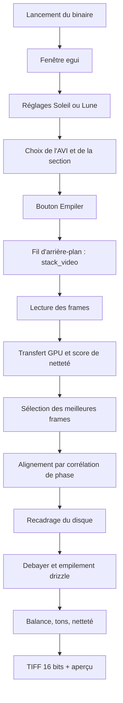

# dubdsr — du démarrage à la fin d’un empilement

dubdsr empile une vidéo AVI RAW SeeStar (Soleil ou Lune) sur le GPU NVIDIA et écrit un TIFF 16 bits à côté de la source. Le programme lancé est un binaire Rust : la fenêtre est `eframe` / `egui`, le calcul d’images passe par CUDA (`cudarc`), et les noyaux GPU sont compilés en PTX au moment de la compilation du binaire puis embarqués dedans.

Point d’entrée : `src/main.rs` appelle `ui::run()`. Tout le reste se joue dans la fenêtre, puis dans un fil d’arrière-plan qui exécute `pipeline::stack_video`.

## Carte du code

| Rôle | Fichier |
| --- | --- |
| Fenêtre, bouton, barre, aperçu | `src/ui.rs` |
| Profils Soleil / Lune, `settings.json` | `src/settings.rs` |
| Orchestration de l’empilement | `src/pipeline/stacker.rs` |
| Lecture AVI / OpenDML | `src/pipeline/avi.rs` |
| Contexte CUDA, netteté, recadrage GPU, drizzle | `src/gpu.rs` |
| Noyaux PTX (flou, demosaic, accumulation) | `kernels/src/lib.rs` |
| Scores et boîte de recadrage | `src/pipeline/crop.rs` |
| Décalages sous-pixel | `src/pipeline/align.rs` |
| Motif Bayer et balance des blancs | `src/pipeline/bayer.rs` |
| Fond, aplatissement, gamma, netteté, masque | `src/pipeline/tone.rs` |
| Écriture TIFF | `src/pipeline/tiff.rs` |
| Textes affichés | `locales/fr.ftl` (et `en`, `es`, `de`) |

## 1. Démarrage

`ui::run()` ouvre une fenêtre native centrée, titre « dubdsr », icône embarquée, taille intérieure 1200 × 941, minimum 900 × 941. Sous Windows le sous-système est fenêtré : pas de console.

À la création de `DubApp` :

1. Thème sombre (fonds bordeaux, texte jaune, contrôles orange) et police grasse du bouton **Empiler** (`segoeuib.ttf` ou `arialbd.ttf`).
2. Chargement de `settings.json`, puis langue de l’interface. Un code enregistré (`fr`, `en`, `es` ou `de`) est réappliqué. Sans code, ou si le fichier est absent, la langue du système est utilisée (anglais si elle n’est pas prise en charge). `Ctrl+L` fait défiler les langues et réécrit le JSON.
3. Le fichier de réglages :
   - Windows : `%APPDATA%\dubdsr\settings.json`
   - Linux : `$XDG_CONFIG_HOME/dubdsr/settings.json`, ou `~/.config/dubdsr/settings.json`
   - Fichier absent ou illisible : profils par défaut, cible Soleil.
4. Le chemin affiché est le dernier fichier du profil actif (`sun` ou `moon`).
5. Sonde GPU : `CudaContext` sur le périphérique 0, nom de la carte et mémoire totale en Go. L’échec n’empêche pas l’ouverture. Une boîte « avertissements au démarrage » reste ouverte tant que CUDA est indisponible. L’empilement échouera plus tard avec le même type d’erreur.
6. Si le chemin pointe vers un AVI lisible, la vidéo est indexée (nombre de frames, images/seconde, largeur, hauteur) et l’aperçu charge la frame du milieu.

Après deux rafraîchissements, la hauteur de la fenêtre est ajustée sur la colonne de réglages. À la fermeture, le chemin courant est recopié dans le profil actif et le JSON est réécrit.

## 2. Ce que la fenêtre prépare

La colonne de gauche porte les réglages. La colonne de droite montre l’aperçu : frame source en gris, puis image empilée une fois le travail fini. L’aperçu source est ramené sur 8 bits par le maximum de la frame. Il se met à jour quand le chemin change, et pendant le glisser de la section (au plus toutes les 40 ms, tout de suite au relâchement).

Deux profils indépendants sont enregistrés. Changer de cible recopie le chemin dans l’ancien profil, charge le dernier fichier de la nouvelle cible, et réécrit le JSON.

Valeurs initiales communes, puis écart Soleil / Lune :

| Réglage | Défaut | Effet sur l’empilement |
| --- | --- | --- |
| Frames conservées | 10 % (pas de 5, de 10 à 100) | Part des frames les plus nettes. Le pipeline impose au moins 5 % et au moins 3 frames quand la vidéo en contient assez. |
| Limite de frames | 0 | 0 = toutes les frames de la zone. Sinon, lecture arrêtée à ce nombre, à partir du début de la zone. |
| Debayer | activé | Reconstruction couleur Bayer. Désactivé : pile en niveaux de gris. |
| Motif Bayer | Auto | `AUTO`, `GRBG`, `GBRG`, `BGGR`, `RGGB`. `GRGB` est accepté comme `GRBG`. |
| Balance des blancs | Lune oui, Soleil non | Gains « monde gris » sur le disque, après l’empilement couleur. |
| Recadrage auto | activé | Carré autour du disque, coins pairs pour garder la phase Bayer. |
| Marge | 5 % | Élargit ce carré. |
| Drizzle x3 | activé | Sortie ×3 en largeur et en hauteur. Désactivé : échelle 1. |
| Aplatir le centre | Soleil 70 %, Lune 0 % | Compense la surexposition centrale. |
| Gamma | 1,2 | Exposant `1/gamma` après l’étirement. |
| Netteté / rayon | 2,0 / 1,0 | Quatre échelles de flou gaussien. |
| Compression Soleil | 0 | Étirement `asinh`. 0 le laisse inactif. |
| Point noir | 0,1 % | Plancher de soustraction. |
| Fond du ciel | activé | Soustrait un niveau estimé dans les coins. |
| Protéger les hautes lumières | activé | Point blanc à 100 %. Désactivé : 99,7 %, ce qui écrête un peu le centre quand l’aplatissement est à 0. |

La zone à empiler est toute la vidéo, ou une section inclusive `[début, fin]` choisie sur le curseur (timecode = index / fps). Le bouton **Empiler** est inactif tant qu’un travail tourne. Si le chemin n’est pas un fichier, une boîte « Fichier manquant » s’ouvre et rien n’est lancé.

## 3. Déclenchement

`start_stack` enregistre les réglages, construit un `StackSettings`, puis lance un fil. L’interface et le fil se parlent par un canal :

- `Progress(étape, fraction)` met à jour le libellé et la barre ;
- `Done(StackResult)` termine avec succès ;
- `Fail(PipelineError)` ouvre la boîte d’échec, texte pris dans le catalogue de langue.

L’interface interroge le canal à chaque image, et redemande un rafraîchissement toutes les 100 ms pendant le travail. Le chronomètre part au clic.

## 4. Lecture de la vidéo

`iter_frames` rouvre l’AVI et ne garde que la zone demandée, puis la limite de frames.

Format accepté : conteneur RIFF `AVI `, y compris les blocs OpenDML `AVIX` (vidéos au-delà du premier gigaoctet). Les images sont les chunks `xxdb` / `xxdc` de la liste `movi`.

Pixels acceptés :

- non compressé (`compression` 0 ou 3), 8, 16, 24 ou 48 bits ;
- fourCC `Y800`, `GREY`, `Y8  `, `Y16 `, `DIB `.

Chaque frame devient un plan `f32` en unités 16 bits (0…65535). Le 8 bits est étiré par `65535/255`. Une frame 24 ou 48 bits dont R = G = B est traitée comme du gris brut ; sinon elle est convertie en luminance (coefficients 0,299 / 0,587 / 0,114). Les lignes bas-en-haut du DIB sont retournées ; une hauteur négative dans l’en-tête est déjà haut-en-bas.

Les frames sont concaténées en un seul tampon. La barre occupe 0 à 25 % pendant cette lecture (`Lecture AVI`, puis `Lecture des frames…` tous les 25 images, puis `Lecture terminée`).

## 5. Transfert et score de netteté

`Gpu::new()` ouvre CUDA, charge le PTX embarqué, et envoie deux noyaux gaussiens (sigma 1,5 et sigma 6). Le volume entier monte en VRAM. Une erreur mémoire devient le message « la vidéo ne tient pas dans la mémoire de la carte ».

Pour chaque frame, sur le GPU :

1. Flou fin (sigma 1,5), puis haute fréquence = image − flou fin.
2. Flou large (sigma 6). Son maximum par ligne donne le pic de la frame.
3. Si ce pic est nul, le score est la variance de la haute fréquence sur toute l’image.
4. Sinon un masque garde les pixels du flou large au-dessus de 60 % du pic, et le score est la variance de la haute fréquence dans ce masque. Moins de 17 pixels masqués : retour à la variance sur toute l’image.

Le score mesure donc le détail dans la zone brillante, en pratique le disque.

## 6. Sélection

`select_top_frames` trie les indices du plus net au moins net. Il en garde `ceil(nombre × ratio)`, au moins 3, sans dépasser le nombre lu. Le ratio reçu est déjà en fraction (10 % saisis → 0,10) puis borné entre 0,05 et 1.

La première frame retenue est la référence : alignement à (0, 0), et c’est elle qui sert à trouver le disque.

## 7. Alignement

Les frames retenues redescendent en mémoire hôte. Pour chacune, sauf la référence :

1. Soustraction de la moyenne, passage en complexe.
2. FFT 2D de la référence (une seule fois) et de la frame.
3. Spectre croisé normalisé : `FFT(réf) × conj(FFT(frame)) / module`.
4. FFT inverse. Le pic de la corrélation est le décalage entier.
5. Un ajustement parabolique sur les voisins donne le sous-pixel. Un pic dans la seconde moitié de l’image est replié en décalage négatif.

Le résultat est une paire `(dy, dx)` par frame : de combien il faudra décaler l’échantillonnage pour ramener le contenu sur la référence. Cette étape fait avancer la barre de 55 % à 62 %.

## 8. Recadrage

Si le recadrage auto est actif, sur la frame de référence :

- seuil = 8 % du pic ;
- on ne garde que les pixels au-dessus du seuil qui ont au moins un voisin 4-connexe lui aussi au-dessus (les pixels chauds isolés sont écartés) ;
- moins de 16 pixels : image entière ;
- sinon le rectangle englobant cette tache, élargi par la marge, centré sur le milieu de l’étendue (un croissant n’est pas recentré sur son limbe brillant) ;
- origine et taille ramenées sur des entiers pairs, pour que le motif Bayer ne change pas de phase.

Sinon la boîte est l’image entière, sans cet alignement pair.

Le GPU copie ensuite chaque frame retenue dans cette boîte (`crop_f32`). Le volume complet est libéré. La barre affiche `Recadrage` à 62 %.

## 9. Motif Bayer

Avec le debayer :

- motif fixé : il est traduit en code (`BGGR` 0, `RGGB` 1, `GRBG` 2, `GBRG` 3) ;
- `AUTO` : la première frame recadrée est redescendue, les quatre motifs sont dématricés, et le plus bas score gagne.

Le score, calculé sur le disque (pixels au-dessus de 12 % du pic, sinon 5 %), est :

`chroma + 2 × grille + 0,5 × dominante`

- chroma : écarts moyens |R−G| + |G−B| ;
- grille : résidu laplacien de |R−G|, signe d’un damier résiduel ;
- dominante : écart-type des moyennes R, G, B.

Le nom retenu est affiché à la fin (`Bayer GRBG`, etc.). La barre passe par `Détection motif Bayer` à 68 % seulement dans le cas Auto. Juste avant, elle a déjà affiché `Empilement super-résolu` à 72 % : le libellé revient donc un instant en arrière, puis le vrai empilement commence.

Sans debayer, il n’y a pas de motif et la pile reste à un canal.

## 10. Empilement super-résolu

Échelle `S` = 3 si drizzle, sinon 1. L’image de sortie fait `(hauteur recadrée × S)` par `(largeur recadrée × S)`, en 3 canaux si debayer, sinon 1.

Les scores de netteté deviennent des poids qui somment à 1. Pour chaque frame retenue, sur le GPU :

1. Debayer éventuel : le plan flottant repasse en `u16`, puis un dématriçage bilinéaire produit R, G, B. Au bord, le pixel est copié depuis la ligne et la colonne intérieures. Sur un site rouge : R = valeur, G = moyenne des 4 voisins, B = moyenne des 4 diagonales. Les sites bleu et vert suivent la même logique selon la parité du motif.
2. Pour chaque pixel de sortie `(x, y)`, la source est lue en  
   `sy = y / S − dy`, `sx = x / S − dx`,  
   par interpolation bilinéaire, multipliée par le poids, et ajoutée dans l’accumulateur.

L’accumulateur redescend en mémoire hôte. C’est une moyenne pondérée, déjà à l’échelle des pixels d’origine, dans l’espace recadré et éventuellement ×3.

## 11. Tons

Ordre commun, en couleur (`normalize_rgb`) ou en gris (`normalize_mono`) :

1. **Fond.** Coins = 14 % de la largeur et de la hauteur. Le niveau soustrait est le 90e percentile de ces coins. Si le point noir est > 0, ce niveau est relevé au percentile correspondant de la luminance (ou du gris). Sans la case « fond », seule cette seconde soustraction a lieu. Les valeurs négatives sont coupées à 0.
2. **Balance des blancs** (couleur seulement, case cochée) : sur les pixels au-dessus de 5 % du pic, chaque canal est ramené vers la moyenne des trois moyennes.
3. **Aplatissement** si la force est > 0. Un flou très large (sigma = 0,16 × le plus grand côté) estime l’éclairement. Le gain tire l’image vers 0,55 au niveau médian du disque, entre le gain neutre et le gain pleinement aplati, puis il est borné. Avec l’aplatissement actif, l’étape suivante considère l’image déjà mise à l’échelle et la borne simplement entre 0 et 1 : le point blanc et la compression `asinh` ne s’appliquent pas.
4. **Étirement** quand l’aplatissement est à 0. Le point blanc (100 % ou 99,7 %) fixe le haut ; chaque pixel est divisé par cette valeur. Si la compression Soleil est > 0, un `asinh` comprime les hautes lumières avant le gamma.
5. **Gamma** si l’écart à 1 dépasse 0,001 : `valeur ^ (1/gamma)`.
6. **Netteté** si la quantité est > 0. Quatre passes : détail = image − flou, poids `quantité × 0,6^niveau`, sigma de départ = rayon, doublé à chaque passe. En couleur le détail est calculé sur la luminance et ajouté aux trois canaux.
7. **Masque de disque.** Un fondu ramène vers le noir les pixels dont la luminance d’avant l’aplatissement est sous environ 4 % du pic. Le fond de ciel déjà soustrait reste noir autour du disque.
8. Conversion en `u16` : `valeur × 65535`, bornée à 0…65535.

## 12. Fin

Le fichier s’écrit à côté de la vidéo : `{nom}_stacked.tiff`, 16 bits, RVB si debayer, gris sinon.

Le fil envoie alors `StackResult` (chemin, frames lues, frames gardées, taille, motif, pixels). L’interface :

- met la barre à 100 % et le libellé `Terminé — gardées/lues, Bayer … → chemin` ;
- fige le temps total ;
- remplace l’aperçu par l’image 16 bits ramenée sur 8 bits (`valeur / 257`), en couleur ou en gris.

Une erreur à n’importe quelle étape (ouverture, format, aucune frame, motif inconnu, CUDA, VRAM, écriture) arrête le fil, fige le temps sous « Arrêté après », et ouvre `Échec de l'empilement` avec le message traduit. Le TIFF n’est écrit qu’après la réussite de toutes les étapes précédentes.

## Barre de progression

| Fraction | Libellé | Travail réel |
| --- | --- | --- |
| 0–25 % | Lecture AVI / des frames | Index et décodage CPU |
| 25 % | Transfert GPU | Copie du volume + contexte CUDA |
| 35 % | Analyse netteté | Variance haute fréquence |
| 45 % | Sélection des frames | Tri des scores |
| 55–62 % | Alignement | FFT CPU, frame par frame |
| 62 % | Recadrage | Boîte disque puis copie GPU |
| 72 % puis 68 % si Auto | Empilement, puis détection Bayer | Le libellé Bayer revient en arrière |
| 72 % → 100 % | Empilement super-résolu, puis Terminé | Drizzle, tons et TIFF, sans palier intermédiaire |

Les tons et l’écriture du TIFF n’ont pas d’étape affichée : la barre reste sur l’empilement jusqu’au `Terminé` final.
