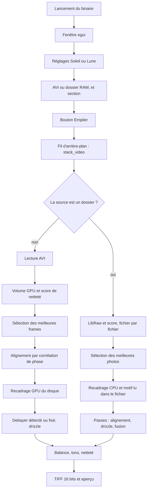
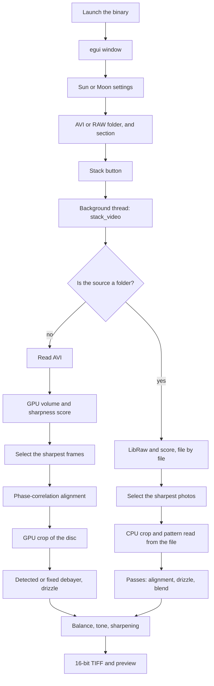

[Français](#français) · [English](#english)

# Français

[English](#english)

# dubdsr — du démarrage à la fin d’un empilement

dubdsr empile une vidéo AVI RAW SeeStar ou une série de photos RAW d’appareil photo (Soleil ou Lune) sur le GPU NVIDIA et écrit un TIFF 16 bits. Le programme lancé est un binaire Rust : la fenêtre est `eframe` / `egui`, le calcul d’images passe par CUDA (`cudarc`), et les noyaux GPU sont compilés en PTX au moment de la compilation du binaire puis embarqués dedans. Le décodage des photos passe par LibRaw, compilé dans le même binaire.

Point d’entrée : `src/main.rs` appelle `ui::run()`. Tout le reste se joue dans la fenêtre, puis dans un fil d’arrière-plan qui exécute `pipeline::stack_video`. Un dossier est envoyé à `stack_raw_folder`. Un fichier suit le chemin AVI.

## Carte du code

| Rôle | Fichier |
| --- | --- |
| Fenêtre, bouton, barre, aperçu | `src/ui.rs` |
| Profils Soleil / Lune, `settings.json` | `src/settings.rs` |
| Orchestration de l’empilement | `src/pipeline/stacker.rs` |
| Lecture AVI / OpenDML | `src/pipeline/avi.rs` |
| Liste, miniature et décodage RAW | `src/pipeline/rawset.rs` |
| Empilement d’un dossier RAW | `src/pipeline/rawstack.rs` |
| Taille des passes selon la VRAM | `src/pipeline/budget.rs` |
| Mosaïque LibRaw, sans dématriçage | `native/mosaic.cpp` |
| Sources LibRaw | `third_party/LibRaw` |
| Contexte CUDA, netteté, recadrage GPU, drizzle | `src/gpu.rs` |
| Noyaux PTX (flou, demosaic, accumulation) | `kernels/src/lib.rs` |
| Scores et boîte de recadrage | `src/pipeline/crop.rs` |
| Décalages sous-pixel | `src/pipeline/align.rs` |
| Motif Bayer et balance des blancs | `src/pipeline/bayer.rs` |
| Fond, aplatissement, gamma, netteté, masque | `src/pipeline/tone.rs` |
| Écriture TIFF | `src/pipeline/tiff.rs` |
| Textes affichés | `locales/fr.ftl` (et `en`, `es`, `de`) |

## 1. Démarrage

`ui::run()` ouvre une fenêtre native centrée, titre « dubdsr », icône embarquée, taille intérieure 1200 × 941, minimum 900 × 941. Sous Windows le sous-système est fenêtré : pas de console.

À la création de `DubApp` :

1. Thème sombre (fonds bordeaux, texte jaune, contrôles orange) et police grasse du bouton **Empiler** (`segoeuib.ttf` ou `arialbd.ttf`).
2. Chargement de `settings.json`, puis langue de l’interface. Un code enregistré (`fr`, `en`, `es` ou `de`) est réappliqué. Sans code, ou si le fichier est absent, la langue du système est utilisée (anglais si elle n’est pas prise en charge). `Ctrl+L` fait défiler les langues et réécrit le JSON.
3. Le fichier de réglages :
   - Windows : `%APPDATA%\dubdsr\settings.json`
   - Linux : `$XDG_CONFIG_HOME/dubdsr/settings.json`, ou `~/.config/dubdsr/settings.json`
   - Fichier absent ou illisible : profils par défaut, cible Soleil.
4. Le chemin affiché est le dernier fichier du profil actif (`sun` ou `moon`).
5. Sonde GPU : `CudaContext` sur le périphérique 0, nom de la carte et mémoire totale en Go. L’échec n’empêche pas l’ouverture. Une boîte « avertissements au démarrage » reste ouverte tant que CUDA est indisponible. L’empilement échouera plus tard avec le même type d’erreur.
6. Si le chemin pointe vers un AVI lisible, la vidéo est indexée (nombre de frames, images/seconde, largeur, hauteur) et l’aperçu charge la frame du milieu. S’il pointe vers un dossier qui contient au moins une photo reconnue, le dossier est listé (nombre de fichiers, images/seconde à 0) et l’aperçu charge le fichier du milieu. Un dossier vide ou illisible est traité comme une source absente.

Après deux rafraîchissements, la hauteur de la fenêtre est ajustée sur la colonne de réglages. À la fermeture, le chemin courant est recopié dans le profil actif et le JSON est réécrit.

## 2. Ce que la fenêtre prépare

La colonne de gauche porte les réglages. La colonne de droite montre l’aperçu : image source, puis image empilée une fois le travail fini. Pour un AVI, l’aperçu est la frame en gris, ramenée sur 8 bits par son maximum. Pour un dossier RAW, c’est la miniature embarquée (JPEG ou bitmap) quand LibRaw en trouve une, sinon la mosaïque décodée en gris, elle aussi ramenée sur 8 bits par son maximum. La miniature et la mosaïque sont sous-échantillonnées pour que le plus grand côté tienne dans 1280 pixels. L’aperçu se met à jour quand le chemin change, et pendant le glisser de la section (au plus toutes les 40 ms, tout de suite au relâchement). Sur un AVI, les curseurs affichent un timecode (index / fps). Sur un dossier, ils affichent le nom du fichier à cet index.

Deux profils indépendants sont enregistrés. Changer de cible recopie le chemin dans l’ancien profil, charge le dernier fichier de la nouvelle cible, et réécrit le JSON.

Valeurs initiales communes, puis écart Soleil / Lune :

| Réglage | Défaut | Effet sur l’empilement |
| --- | --- | --- |
| Frames conservées | 10 % (pas de 5, de 10 à 100) | Part des frames les plus nettes. Le pipeline impose au moins 5 % et au moins 3 frames quand la vidéo en contient assez. |
| Limite de frames | 0 | 0 = toutes les images de la zone. Sinon, la zone est coupée à ce nombre depuis son début : ordre des frames pour un AVI, ordre des noms pour un dossier. |
| Debayer | activé | Reconstruction couleur Bayer. Désactivé : pile en niveaux de gris. |
| Motif Bayer | Auto | `AUTO`, `GRBG`, `GBRG`, `BGGR`, `RGGB`. `GRGB` est accepté comme `GRBG`. Sur un AVI, Auto compare les quatre motifs. Sur un dossier RAW, Auto reprend le motif lu dans les fichiers. |
| Balance des blancs | Lune oui, Soleil non | Gains « monde gris » sur le disque, après l’empilement couleur. |
| Recadrage auto | activé | Carré autour du disque, coins pairs pour garder la phase Bayer. |
| Marge | 5 % | Élargit ce carré. |
| Drizzle x3 | activé | Sortie ×3 en largeur et en hauteur. Désactivé : échelle 1. |
| Aplatir le centre | Soleil 70 %, Lune 0 % | Compense la surexposition centrale. |
| Gamma | 1,2 | Exposant `1/gamma` après l’étirement. |
| Netteté / rayon | 2,0 / 1,0 | Quatre échelles de flou gaussien. |
| Compression Soleil | 0 | Étirement `asinh`. 0 le laisse inactif. |
| Point noir | 0,1 % | Plancher de soustraction. |
| Fond du ciel | activé | Soustrait un niveau estimé dans les coins. |
| Protéger les hautes lumières | activé | Point blanc à 100 %. Désactivé : 99,7 %, ce qui écrête un peu le centre quand l’aplatissement est à 0. |

La zone à empiler est toute la source, ou une section inclusive `[début, fin]` choisie sur le curseur. **Parcourir…** ouvre un AVI. **Dossier…** ouvre un dossier de photos. Le chemin peut aussi être collé dans le champ source. Le bouton **Empiler** est inactif tant qu’un travail tourne. Si le chemin n’est ni un fichier ni un dossier, une boîte « Fichier manquant » s’ouvre (`Sélectionnez un fichier AVI ou un dossier RAW.`) et rien n’est lancé.

## 3. Déclenchement

`start_stack` enregistre les réglages, construit un `StackSettings`, puis lance un fil. L’interface et le fil se parlent par un canal :

- `Progress(étape, fraction)` met à jour le libellé et la barre ;
- `Done(StackResult)` termine avec succès ;
- `Fail(PipelineError)` ouvre la boîte d’échec, texte pris dans le catalogue de langue.

L’interface interroge le canal à chaque image, et redemande un rafraîchissement toutes les 100 ms pendant le travail. Le chronomètre part au clic.

## 4. Lecture de la vidéo

Ce chemin s’applique quand la source est un fichier. Un dossier suit les sections 13 et 14, puis les mêmes tons (section 11) et la même fin (section 12).

`iter_frames` rouvre l’AVI et ne garde que la zone demandée, puis la limite de frames.

Format accepté : conteneur RIFF `AVI `, y compris les blocs OpenDML `AVIX` (vidéos au-delà du premier gigaoctet). Les images sont les chunks `xxdb` / `xxdc` de la liste `movi`.

Pixels acceptés :

- non compressé (`compression` 0 ou 3), 8, 16, 24 ou 48 bits ;
- fourCC `Y800`, `GREY`, `Y8  `, `Y16 `, `DIB `.

Chaque frame devient un plan `f32` en unités 16 bits (0…65535). Le 8 bits est étiré par `65535/255`. Une frame 24 ou 48 bits dont R = G = B est traitée comme du gris brut ; sinon elle est convertie en luminance (coefficients 0,299 / 0,587 / 0,114). Les lignes bas-en-haut du DIB sont retournées ; une hauteur négative dans l’en-tête est déjà haut-en-bas.

Les frames sont concaténées en un seul tampon. La barre occupe 0 à 25 % pendant cette lecture (`Lecture AVI`, puis `Lecture des frames…` tous les 25 images, puis `Lecture terminée`).

## 5. Transfert et score de netteté

`Gpu::new()` ouvre CUDA, charge le PTX embarqué, et envoie deux noyaux gaussiens (sigma 1,5 et sigma 6). Le volume entier monte en VRAM. Une erreur mémoire devient le message « la vidéo ne tient pas dans la mémoire de la carte ».

Pour chaque frame, sur le GPU :

1. Flou fin (sigma 1,5), puis haute fréquence = image − flou fin.
2. Flou large (sigma 6). Son maximum par ligne donne le pic de la frame.
3. Si ce pic est nul, le score est la variance de la haute fréquence sur toute l’image.
4. Sinon un masque garde les pixels du flou large au-dessus de 60 % du pic, et le score est la variance de la haute fréquence dans ce masque. Moins de 17 pixels masqués : retour à la variance sur toute l’image.

Le score mesure donc le détail dans la zone brillante, en pratique le disque.

## 6. Sélection

`select_top_frames` trie les indices du plus net au moins net. Il en garde `ceil(nombre × ratio)`, au moins 3, sans dépasser le nombre lu. Le ratio reçu est déjà en fraction (10 % saisis → 0,10) puis borné entre 0,05 et 1.

La première frame retenue est la référence : alignement à (0, 0), et c’est elle qui sert à trouver le disque.

## 7. Alignement

Les frames retenues redescendent en mémoire hôte. Pour chacune, sauf la référence :

1. Soustraction de la moyenne, passage en complexe.
2. FFT 2D de la référence (une seule fois) et de la frame.
3. Spectre croisé normalisé : `FFT(réf) × conj(FFT(frame)) / module`.
4. FFT inverse. Le pic de la corrélation est le décalage entier.
5. Un ajustement parabolique sur les voisins donne le sous-pixel. Un pic dans la seconde moitié de l’image est replié en décalage négatif.

Le résultat est une paire `(dy, dx)` par frame : de combien il faudra décaler l’échantillonnage pour ramener le contenu sur la référence. Cette étape fait avancer la barre de 55 % à 62 %.

## 8. Recadrage

Si le recadrage auto est actif, sur la frame de référence :

- seuil = 8 % du pic ;
- on ne garde que les pixels au-dessus du seuil qui ont au moins un voisin 4-connexe lui aussi au-dessus (les pixels chauds isolés sont écartés) ;
- moins de 16 pixels : image entière ;
- sinon le rectangle englobant cette tache, élargi par la marge, centré sur le milieu de l’étendue (un croissant n’est pas recentré sur son limbe brillant) ;
- origine et taille ramenées sur des entiers pairs, pour que le motif Bayer ne change pas de phase.

Sinon la boîte est l’image entière, sans cet alignement pair.

Sur le chemin AVI, le GPU copie ensuite chaque frame retenue dans cette boîte (`crop_f32`). Le volume complet est libéré. La barre affiche `Recadrage` à 62 %. Sur un dossier RAW, la même boîte est calculée sur la référence, puis chaque photo est coupée sur le CPU par `crop_plane` au moment de sa passe.

## 9. Motif Bayer

Sur un AVI, avec le debayer :

- motif fixé : il est traduit en code (`BGGR` 0, `RGGB` 1, `GRBG` 2, `GBRG` 3) ;
- `AUTO` : la première frame recadrée est redescendue, les quatre motifs sont dématricés, et le plus bas score gagne.

Sur un dossier RAW, le motif vient de LibRaw après orientation (section 14). La détection par score n’est pas relancée.

Le score Auto d’un AVI, calculé sur le disque (pixels au-dessus de 12 % du pic, sinon 5 %), est :

`chroma + 2 × grille + 0,5 × dominante`

- chroma : écarts moyens |R−G| + |G−B| ;
- grille : résidu laplacien de |R−G|, signe d’un damier résiduel ;
- dominante : écart-type des moyennes R, G, B.

Le nom retenu est affiché à la fin (`Bayer GRBG`, etc.). La barre passe par `Détection motif Bayer` à 68 % seulement dans le cas Auto. Juste avant, elle a déjà affiché `Empilement super-résolu` à 72 % : le libellé revient donc un instant en arrière, puis le vrai empilement commence.

Sans debayer, il n’y a pas de motif et la pile reste à un canal.

## 10. Empilement super-résolu

Échelle `S` = 3 si drizzle, sinon 1. L’image de sortie fait `(hauteur recadrée × S)` par `(largeur recadrée × S)`, en 3 canaux si debayer, sinon 1.

Les scores de netteté deviennent des poids qui somment à 1. Pour chaque frame retenue, sur le GPU :

1. Debayer éventuel : le plan flottant repasse en `u16`, puis un dématriçage bilinéaire produit R, G, B. Au bord, le pixel est copié depuis la ligne et la colonne intérieures. Sur un site rouge : R = valeur, G = moyenne des 4 voisins, B = moyenne des 4 diagonales. Les sites bleu et vert suivent la même logique selon la parité du motif.
2. Pour chaque pixel de sortie `(x, y)`, la source est lue en  
   `sy = y / S − dy`, `sx = x / S − dx`,  
   par interpolation bilinéaire, multipliée par le poids, et ajoutée dans l’accumulateur.

L’accumulateur redescend en mémoire hôte. C’est une moyenne pondérée, déjà à l’échelle des pixels d’origine, dans l’espace recadré et éventuellement ×3.

## 11. Tons

Ordre commun, en couleur (`normalize_rgb`) ou en gris (`normalize_mono`) :

1. **Fond.** Coins = 14 % de la largeur et de la hauteur. Le niveau soustrait est le 90e percentile de ces coins. Si le point noir est > 0, ce niveau est relevé au percentile correspondant de la luminance (ou du gris). Sans la case « fond », seule cette seconde soustraction a lieu. Les valeurs négatives sont coupées à 0.
2. **Balance des blancs** (couleur seulement, case cochée) : sur les pixels au-dessus de 5 % du pic, chaque canal est ramené vers la moyenne des trois moyennes.
3. **Aplatissement** si la force est > 0. Un flou très large (sigma = 0,16 × le plus grand côté) estime l’éclairement. Le gain tire l’image vers 0,55 au niveau médian du disque, entre le gain neutre et le gain pleinement aplati, puis il est borné. Avec l’aplatissement actif, l’étape suivante considère l’image déjà mise à l’échelle et la borne simplement entre 0 et 1 : le point blanc et la compression `asinh` ne s’appliquent pas.
4. **Étirement** quand l’aplatissement est à 0. Le point blanc (100 % ou 99,7 %) fixe le haut ; chaque pixel est divisé par cette valeur. Si la compression Soleil est > 0, un `asinh` comprime les hautes lumières avant le gamma.
5. **Gamma** si l’écart à 1 dépasse 0,001 : `valeur ^ (1/gamma)`.
6. **Netteté** si la quantité est > 0. Quatre passes : détail = image − flou, poids `quantité × 0,6^niveau`, sigma de départ = rayon, doublé à chaque passe. En couleur le détail est calculé sur la luminance et ajouté aux trois canaux.
7. **Masque de disque.** Un fondu ramène vers le noir les pixels dont la luminance d’avant l’aplatissement est sous environ 4 % du pic. Le fond de ciel déjà soustrait reste noir autour du disque.
8. Conversion en `u16` : `valeur × 65535`, bornée à 0…65535.

## 12. Fin

`write_result` écrit le TIFF 16 bits après les tons. Pour une vidéo, il est à côté du fichier : `{nom}_stacked.tiff`. Pour un dossier, il est dans le dossier : `{dossier}_stacked.tiff`. RVB si un motif Bayer a été appliqué, gris sinon. Une série monochrome reste en gris même si le debayer est coché.

Le fil envoie alors `StackResult` (chemin, frames lues, frames gardées, taille, motif, pixels). L’interface :

- met la barre à 100 % et le libellé `Terminé — gardées/lues, Bayer … → chemin` ;
- fige le temps total ;
- remplace l’aperçu par l’image 16 bits ramenée sur 8 bits (`valeur / 257`), en couleur ou en gris.

Une erreur à n’importe quelle étape (ouverture, format, aucune frame, motif inconnu, CUDA, VRAM, écriture) arrête le fil, fige le temps sous « Arrêté après », et ouvre `Échec de l'empilement` avec le message traduit. Le TIFF n’est écrit qu’après la réussite de toutes les étapes précédentes.

## Barre de progression d’une vidéo

| Fraction | Libellé | Travail réel |
| --- | --- | --- |
| 0–25 % | Lecture AVI / des frames | Index et décodage CPU |
| 25 % | Transfert GPU | Copie du volume + contexte CUDA |
| 35 % | Analyse netteté | Variance haute fréquence |
| 45 % | Sélection des frames | Tri des scores |
| 55–62 % | Alignement | FFT CPU, frame par frame |
| 62 % | Recadrage | Boîte disque puis copie GPU |
| 72 % puis 68 % si Auto | Empilement, puis détection Bayer | Le libellé Bayer revient en arrière |
| 72 % → 100 % | Empilement super-résolu, puis Terminé | Drizzle, tons et TIFF, sans palier intermédiaire |

Les tons et l’écriture du TIFF n’ont pas d’étape affichée : la barre reste sur l’empilement jusqu’au `Terminé` final.

## 13. Dossier RAW : liste et décodage

`list_raw_files` ne lit que les fichiers du dossier, sans descendre dans les sous-dossiers. L’extension, en minuscules, doit être l’une de :

`cr2`, `cr3`, `nef`, `nrw`, `orf`, `pef`, `arw`, `dng`, `raf`, `rw2`

Les JPEG, XMP et autres fichiers sont ignorés. Les noms retenus sont triés sans tenir compte de la casse. La zone `[début, fin]`, puis la limite de frames, coupent cette liste. Une liste vide donne « Aucune photo RAW dans le dossier. »

Chaque photo retenue pour le calcul passe par `decode_raw`, qui appelle `native/mosaic.cpp`. Sous Windows le chemin est UTF-16. Ailleurs il est une suite d’octets. LibRaw ouvre le fichier et `extract_mosaic` sort la mosaïque, sans la dématricer.

Refusés, avec « RAW non pris en charge » : sRAW, rotation Fuji, flottant, motif autre que Bayer (le filtre LibRaw est alors inférieur à 1000), absence de plan `raw_image`, cadre actif invalide, motif illisible. Un capteur à un seul canal (`filters` nul et au plus une couleur) est accepté : le code Bayer renvoyé vaut −1.

Le cadre actif est `sizes.width` × `sizes.height`, décalé de `left_margin` et `top_margin`. Une largeur ou une hauteur impaire est raccourcie d’un pixel pour garder une mosaïque paire. Le noir de chaque pixel est `black`, plus le noir du canal, plus le motif périodique `cblack` quand il existe. Le blanc est `color.maximum`, sinon `2^bits − 1`, sinon 65535. La valeur écrite est `(échantillon − noir) × 65535 / (blanc − noir)`, bornée à 0…65535.

`sizes.flip` est renvoyé tel quel. Rust l’applique dans `orient_mosaic`, et réécrit le motif pour que le carré 2×2 en haut à gauche suive les pixels :

- bit 0 : miroir horizontal ;
- bit 1 : miroir vertical ;
- bit 2 (valeur 4) : transposition des lignes et des colonnes.

Les codes renvoyés par LibRaw deviennent `BGGR`, `RGGB`, `GRBG`, `GBRG`. Un code hors de 0…3 arrête le décodage.

L’aperçu demande d’abord la miniature (`full = 0`) : JPEG, bitmap RVB, ou bitmap gris. À défaut, la mosaïque complète est décodée et affichée en gris. Une ouverture ou un dépaquetage raté donne « Impossible d'ouvrir le RAW », avec le nom du fichier et le texte LibRaw quand il y en a un.

## 14. Dossier RAW : empilement

`stack_raw_folder` ouvre CUDA une fois, puis décode chaque photo de la zone. Largeur, hauteur et motif doivent rester ceux de la première photo. Un écart donne « Ce fichier ne va pas avec la série », avec le nom du fichier. Chaque mosaïque monte seule sur le GPU, reçoit le même score de netteté que les frames AVI (section 5), puis quitte la carte. La série entière ne réside donc pas en VRAM pendant cette lecture. La barre affiche `Lecture des RAW i/n` de 0 à 25 %.

La sélection est celle de la section 6. La référence est la photo la plus nette. Elle est redécodée et sert au recadrage (section 8, sur le CPU) et au spectre de phase. Le spectre est celui de la mosaïque entière, calculé une fois.

`packet_len` mesure la mémoire libre et n’en utilise que 60 %. Le coût fixe est l’accumulateur de sortie, plus le tampon de dématriçage quand il y a trois canaux. Le coût par photo est le plan recadré. Si l’accumulateur et une seule photo dépassent déjà ce budget, l’empilement s’arrête avec le message de mémoire de la carte et le nombre de Go libres. Sinon les photos gardées sont groupées en passes de cette taille.

Dans chaque passe, les photos sont rouvertes. La référence déjà en mémoire n’est pas relue. Le décalage `(dy, dx)` vient de `PhaseReference::shift_of` sur la mosaïque entière : même corrélation de phase que la section 7, sans libellé « Alignement ». Le plan est ensuite coupé par `crop_plane` dans la boîte commune, empilé par `Gpu::superres` (section 10), et la moyenne de la passe est ajoutée à l’accumulateur hôte avec pour poids la somme des scores de la passe. Après la dernière passe, l’accumulateur est divisé par la somme de ces poids : c’est la moyenne pondérée de toutes les photos gardées.

Le motif, avant les passes :

- debayer décoché : un canal, pas de nom de motif ;
- `AUTO` et un motif présent dans la série : ce motif, code inchangé (`BGGR` 0, `RGGB` 1, `GRBG` 2, `GBRG` 3) ;
- `AUTO` sur une série monochrome : un canal ;
- motif fixé : ce nom, ou « Motif Bayer inconnu » s’il n’est pas reconnu.

Les tons et le TIFF suivent les sections 11 et 12. `stage.done` met la barre à 100 %.

| Fraction | Libellé | Travail réel |
| --- | --- | --- |
| 0–25 % | Lecture des RAW i/n | Décodage LibRaw, score GPU d’une photo, libération |
| 30 % | Sélection des frames | Tri des scores |
| 34 % | Recadrage | Boîte du disque, puis taille des passes |
| 36 %, puis vers 92 % | Passe i/n | Réouverture, alignement, recadrage CPU, drizzle, fusion |
| 100 % | Terminé | Tons et TIFF, sans palier intermédiaire |

Le début de la passe `p` (à partir de 0) parmi `P` passes vaut `0,36 + 0,56 × p / P`. Une seule passe reste donc affichée à 36 % jusqu’au `Terminé`.

# English

[Français](#français)

# dubdsr — from startup to the end of a stack

dubdsr stacks a SeeStar RAW AVI video or a series of camera RAW photos (Sun or Moon) on an NVIDIA GPU and writes a 16-bit TIFF. The program you run is a Rust binary: the window is `eframe` / `egui`, image math goes through CUDA (`cudarc`), and the GPU kernels are compiled to PTX when the binary is built, then embedded in it. Photo decoding goes through LibRaw, compiled into the same binary.

Entry point: `src/main.rs` calls `ui::run()`. Everything else happens in the window, then in a background thread that runs `pipeline::stack_video`. A folder is sent to `stack_raw_folder`. A file follows the AVI path.

## Code map

| Role | File |
| --- | --- |
| Window, button, bar, preview | `src/ui.rs` |
| Sun / Moon profiles, `settings.json` | `src/settings.rs` |
| Stacking orchestration | `src/pipeline/stacker.rs` |
| AVI / OpenDML reading | `src/pipeline/avi.rs` |
| RAW listing, thumbnail, and decoding | `src/pipeline/rawset.rs` |
| Stacking a RAW folder | `src/pipeline/rawstack.rs` |
| Pass size from VRAM | `src/pipeline/budget.rs` |
| LibRaw mosaic, without demosaic | `native/mosaic.cpp` |
| LibRaw sources | `third_party/LibRaw` |
| CUDA context, sharpness, GPU crop, drizzle | `src/gpu.rs` |
| PTX kernels (blur, demosaic, accumulation) | `kernels/src/lib.rs` |
| Scores and crop box | `src/pipeline/crop.rs` |
| Sub-pixel shifts | `src/pipeline/align.rs` |
| Bayer pattern and white balance | `src/pipeline/bayer.rs` |
| Background, flatten, gamma, sharpen, mask | `src/pipeline/tone.rs` |
| TIFF writing | `src/pipeline/tiff.rs` |
| Displayed text | `locales/fr.ftl` (and `en`, `es`, `de`) |

## 1. Startup

`ui::run()` opens a centered native window, title “dubdsr”, embedded icon, inner size 1200 × 941, minimum 900 × 941. On Windows the subsystem is windowed: no console.

When `DubApp` is created:

1. Dark theme (burgundy backgrounds, yellow text, orange controls) and the bold font of the **Stack** button (`segoeuib.ttf` or `arialbd.ttf`).
2. Load `settings.json`, then the interface language. A saved code (`fr`, `en`, `es`, or `de`) is applied again. With no code, or if the file is missing, the system language is used (English when it is not supported). `Ctrl+L` cycles the languages and rewrites the JSON.
3. The settings file:
   - Windows: `%APPDATA%\dubdsr\settings.json`
   - Linux: `$XDG_CONFIG_HOME/dubdsr/settings.json`, or `~/.config/dubdsr/settings.json`
   - Missing or unreadable file: default profiles, Sun target.
4. The displayed path is the last file of the active profile (`sun` or `moon`).
5. GPU probe: `CudaContext` on device 0, card name, and total memory in GB. Failure does not prevent the window from opening. A “startup warnings” box stays open while CUDA is unavailable. Stacking fails later with the same kind of error.
6. If the path points to a readable AVI, the video is indexed (frame count, frames per second, width, height) and the preview loads the middle frame. If it points to a folder that contains at least one recognized photo, the folder is listed (file count, frames per second at 0) and the preview loads the middle file. An empty or unreadable folder is treated as a missing source.

After two refreshes, the window height is fitted to the settings column. On close, the current path is copied into the active profile and the JSON is rewritten.

## 2. What the window prepares

The left column holds the settings. The right column shows the preview: the source image, then the stacked image once the job is finished. For an AVI, the preview is the frame in gray, scaled to 8 bits by its maximum. For a RAW folder, it is the embedded thumbnail (JPEG or bitmap) when LibRaw finds one, otherwise the decoded mosaic in gray, also scaled to 8 bits by its maximum. The thumbnail and the mosaic are subsampled so the long edge fits in 1280 pixels. The preview updates when the path changes, and while the section slider is dragged (at most every 40 ms, immediately on release). On an AVI, the sliders show a timecode (index / fps). On a folder, they show the file name at that index.

Two independent profiles are saved. Changing the target copies the path into the previous profile, loads the last file of the new target, and rewrites the JSON.

Shared initial values, then the Sun / Moon difference:

| Setting | Default | Effect on the stack |
| --- | --- | --- |
| Frames kept | 10% (step 5, from 10 to 100) | Share of the sharpest frames. The pipeline requires at least 5% and at least 3 frames when the video has enough. |
| Frame limit | 0 | 0 = every image in the range. Otherwise the range is cut to that count from its start: frame order for an AVI, name order for a folder. |
| Debayer | on | Bayer color reconstruction. Off: a grayscale stack. |
| Bayer pattern | Auto | `AUTO`, `GRBG`, `GBRG`, `BGGR`, `RGGB`. `GRGB` is accepted as `GRBG`. On an AVI, Auto compares the four patterns. On a RAW folder, Auto uses the pattern read from the files. |
| White balance | Moon yes, Sun no | Gray-world gains on the disc, after the color stack. |
| Auto crop | on | Square around the disc, even corners so the Bayer phase stays put. |
| Margin | 5% | Widens that square. |
| Drizzle x3 | on | Output ×3 in width and height. Off: scale 1. |
| Flatten center | Sun 70%, Moon 0% | Compensates central overexposure. |
| Gamma | 1.2 | Exponent `1/gamma` after the stretch. |
| Sharpen / radius | 2.0 / 1.0 | Four Gaussian blur scales. |
| Sun compression | 0 | `asinh` stretch. 0 leaves it inactive. |
| Black point | 0.1% | Subtraction floor. |
| Sky background | on | Subtracts a level estimated in the corners. |
| Protect highlights | on | White point at 100%. Off: 99.7%, which clips the center a little when flattening is 0. |

The range to stack is the whole source, or an inclusive section `[start, end]` chosen on the slider. **Browse…** opens an AVI. **Folder…** opens a folder of photos. The path can also be pasted into the source field. The **Stack** button stays inactive while a job is running. If the path is neither a file nor a folder, a “Missing file” box opens (`Select an AVI file or a RAW folder.`) and nothing is started.

## 3. Trigger

`start_stack` saves the settings, builds a `StackSettings`, then starts a thread. The interface and the thread talk through a channel:

- `Progress(stage, fraction)` updates the label and the bar;
- `Done(StackResult)` finishes successfully;
- `Fail(PipelineError)` opens the failure box, with text taken from the language catalog.

The interface polls the channel on every frame, and asks for another refresh every 100 ms while the job runs. The timer starts at the click.

## 4. Reading the video

This path applies when the source is a file. A folder follows sections 13 and 14, then the same tone stage (section 11) and the same finish (section 12).

`iter_frames` reopens the AVI and keeps only the requested range, then the frame limit.

Accepted format: RIFF `AVI ` container, including OpenDML `AVIX` blocks (videos past the first gigabyte). Images are the `xxdb` / `xxdc` chunks of the `movi` list.

Accepted pixels:

- uncompressed (`compression` 0 or 3), 8, 16, 24, or 48 bits;
- fourCC `Y800`, `GREY`, `Y8  `, `Y16 `, `DIB `.

Each frame becomes an `f32` plane in 16-bit units (0…65535). 8-bit data is stretched by `65535/255`. A 24- or 48-bit frame whose R = G = B is treated as raw gray; otherwise it is converted to luminance (coefficients 0.299 / 0.587 / 0.114). Bottom-up DIB rows are flipped; a negative height in the header is already top-down.

Frames are concatenated into one buffer. The bar occupies 0 to 25% during this read (`Reading AVI`, then `Reading frames…` every 25 images, then `Read complete`).

## 5. Transfer and sharpness score

`Gpu::new()` opens CUDA, loads the embedded PTX, and uploads two Gaussian kernels (sigma 1.5 and sigma 6). The whole volume goes up to VRAM. An out-of-memory error becomes the message “The video does not fit in GPU memory”.

For each frame, on the GPU:

1. Fine blur (sigma 1.5), then high frequency = image − fine blur.
2. Wide blur (sigma 6). Its per-row maximum gives the frame peak.
3. If that peak is zero, the score is the variance of the high frequency over the whole image.
4. Otherwise a mask keeps wide-blur pixels above 60% of the peak, and the score is the variance of the high frequency inside that mask. Fewer than 17 masked pixels: fall back to the variance over the whole image.

The score therefore measures detail in the bright area, in practice the disc.

## 6. Selection

`select_top_frames` sorts indexes from sharpest to least sharp. It keeps `ceil(count × ratio)`, at least 3, and never more than the number read. The incoming ratio is already a fraction (10% entered → 0.10), then clamped between 0.05 and 1.

The first kept frame is the reference: alignment at (0, 0), and it is the frame used to find the disc.

## 7. Alignment

The kept frames come back to host memory. For each one except the reference:

1. Subtract the mean, convert to complex.
2. 2D FFT of the reference (once) and of the frame.
3. Normalized cross spectrum: `FFT(ref) × conj(FFT(frame)) / magnitude`.
4. Inverse FFT. The correlation peak is the integer shift.
5. A parabolic fit on the neighbors gives the sub-pixel shift. A peak in the second half of the image is wrapped to a negative shift.

The result is a pair `(dy, dx)` per frame: how far sampling must shift to bring the content onto the reference. This stage moves the bar from 55% to 62%.

## 8. Crop

When auto crop is on, on the reference frame:

- threshold = 8% of the peak;
- keep only pixels above the threshold that have at least one 4-connected neighbor also above it (isolated hot pixels are dropped);
- fewer than 16 pixels: the whole image;
- otherwise the bounding rectangle of that blob, expanded by the margin, centered on the middle of the extent (a crescent is not recentered on its bright limb);
- origin and size snapped to even integers, so the Bayer pattern does not change phase.

Otherwise the box is the whole image, without that even snap.

On the AVI path, the GPU then copies each kept frame into this box (`crop_f32`). The full volume is released. The bar shows `Cropping` at 62%. On a RAW folder, the same box is computed on the reference, then each photo is cut on the CPU by `crop_plane` during its pass.

## 9. Bayer pattern

On an AVI, with debayer:

- a fixed pattern is translated to a code (`BGGR` 0, `RGGB` 1, `GRBG` 2, `GBRG` 3);
- `AUTO`: the first cropped frame is downloaded, the four patterns are demosaiced, and the lowest score wins.

On a RAW folder, the pattern comes from LibRaw after orientation (section 14). Score detection is not run again.

The Auto score of an AVI, computed on the disc (pixels above 12% of the peak, otherwise 5%), is:

`chroma + 2 × grid + 0.5 × dominant`

- chroma: mean gaps |R−G| + |G−B|;
- grid: Laplacian residual of |R−G|, a sign of a leftover checkerboard;
- dominant: standard deviation of the R, G, and B means.

The chosen name is shown at the end (`Bayer GRBG`, and so on). The bar passes through `Bayer pattern detection` at 68% only in the Auto case. Just before that, it has already shown `Super-resolution stacking` at 72%: the label therefore steps backward for a moment, then the real stack begins.

With debayer off, there is no pattern and the stack stays single-channel.

## 10. Super-resolution stacking

Scale `S` = 3 when drizzle is on, otherwise 1. The output image is `(cropped height × S)` by `(cropped width × S)`, 3 channels when debayer is on, otherwise 1.

Sharpness scores become weights that sum to 1. For each kept frame, on the GPU:

1. Optional debayer: the float plane is converted back to `u16`, then a bilinear demosaic produces R, G, B. At the border, the pixel is copied from the inner row and column. On a red site: R = value, G = mean of the 4 neighbors, B = mean of the 4 diagonals. Blue and green sites follow the same logic according to the pattern parity.
2. For each output pixel `(x, y)`, the source is read at  
   `sy = y / S − dy`, `sx = x / S − dx`,  
   by bilinear interpolation, multiplied by the weight, and added into the accumulator.

The accumulator comes back to host memory. It is a weighted average, already at the scale of the original pixels, in the cropped space and possibly ×3.

## 11. Tone

Shared order, in color (`normalize_rgb`) or in gray (`normalize_mono`):

1. **Background.** Corners = 14% of the width and of the height. The subtracted level is the 90th percentile of those corners. If the black point is > 0, that level is raised to the matching percentile of the luminance (or of the gray). With the background box off, only this second subtraction happens. Negative values are cut to 0.
2. **White balance** (color only, box checked): on pixels above 5% of the peak, each channel is pulled toward the mean of the three means.
3. **Flatten** when strength is > 0. A very wide blur (sigma = 0.16 × the longer side) estimates the illumination. The gain pulls the image toward 0.55 at the median level of the disc, between the neutral gain and the fully flattened gain, then it is clamped. With flattening on, the next stage treats the image as already scaled and simply clamps it between 0 and 1: the white point and the `asinh` compression do not apply.
4. **Stretch** when flattening is 0. The white point (100% or 99.7%) sets the top; each pixel is divided by that value. If Sun compression is > 0, an `asinh` compresses the highlights before gamma.
5. **Gamma** when the gap from 1 exceeds 0.001: `value ^ (1/gamma)`.
6. **Sharpen** when the amount is > 0. Four passes: detail = image − blur, weight `amount × 0.6^level`, starting sigma = radius, doubled at each pass. In color the detail is computed on luminance and added to the three channels.
7. **Disc mask.** A fade pulls toward black the pixels whose luminance from before flattening is under about 4% of the peak. The sky background already subtracted stays black around the disc.
8. Conversion to `u16`: `value × 65535`, clamped to 0…65535.

## 12. Finish

`write_result` writes the 16-bit TIFF after the tone stage. For a video, it sits next to the file: `{name}_stacked.tiff`. For a folder, it sits inside the folder: `{folder}_stacked.tiff`. RGB when a Bayer pattern was applied, gray otherwise. A monochrome series stays gray even when debayer is checked.

The thread then sends `StackResult` (path, frames read, frames kept, size, pattern, pixels). The interface:

- sets the bar to 100% and the label `Done — kept/read, Bayer … → path`;
- freezes the total time;
- replaces the preview with the 16-bit image scaled to 8 bits (`value / 257`), in color or in gray.

An error at any stage (open, format, no frames, unknown pattern, CUDA, VRAM, write) stops the thread, freezes the time under “Stopped after”, and opens `Stacking failed` with the translated message. The TIFF is written only after every previous stage has succeeded.

## Progress bar of a video

| Fraction | Label | Actual work |
| --- | --- | --- |
| 0–25% | Reading AVI / frames | Index and CPU decode |
| 25% | GPU transfer | Volume copy + CUDA context |
| 35% | Sharpness analysis | High-frequency variance |
| 45% | Frame selection | Score sort |
| 55–62% | Alignment | CPU FFT, frame by frame |
| 62% | Cropping | Disc box, then GPU copy |
| 72% then 68% if Auto | Stacking, then Bayer detection | The Bayer label steps backward |
| 72% → 100% | Super-resolution stacking, then Done | Drizzle, tone, and TIFF, with no step in between |

Tone and the TIFF write have no displayed stage: the bar stays on stacking until the final `Done`.

## 13. RAW folder: listing and decoding

`list_raw_files` reads only the files in the folder, and does not walk into subfolders. The extension, in lowercase, must be one of:

`cr2`, `cr3`, `nef`, `nrw`, `orf`, `pef`, `arw`, `dng`, `raf`, `rw2`

JPEG, XMP, and other files are ignored. The kept names are sorted without regard to case. The `[start, end]` range, then the frame limit, cut this list. An empty list produces “No RAW photos in the folder.”

Each photo kept for the computation goes through `decode_raw`, which calls `native/mosaic.cpp`. On Windows the path is UTF-16. Elsewhere it is a byte string. LibRaw opens the file and `extract_mosaic` returns the mosaic, without demosaicing it.

Rejected, with “Unsupported RAW file”: sRAW, Fuji rotation, floating point, a pattern other than Bayer (the LibRaw filter is then below 1000), a missing `raw_image` plane, an invalid active area, an unreadable pattern. A single-channel sensor (`filters` zero and at most one color) is accepted: the returned Bayer code is −1.

The active area is `sizes.width` × `sizes.height`, offset by `left_margin` and `top_margin`. An odd width or height is shortened by one pixel so the mosaic stays even. The black of each pixel is `black`, plus the channel black, plus the periodic `cblack` pattern when it exists. White is `color.maximum`, otherwise `2^bits − 1`, otherwise 65535. The stored value is `(sample − black) × 65535 / (white − black)`, clamped to 0…65535.

`sizes.flip` is returned as is. Rust applies it in `orient_mosaic`, and rewrites the pattern so the top-left 2×2 square follows the pixels:

- bit 0: horizontal mirror;
- bit 1: vertical mirror;
- bit 2 (value 4): transpose of rows and columns.

The codes returned by LibRaw become `BGGR`, `RGGB`, `GRBG`, `GBRG`. A code outside 0…3 stops decoding.

The preview asks for the thumbnail first (`full = 0`): JPEG, RGB bitmap, or gray bitmap. If there is none, the full mosaic is decoded and shown in gray. A failed open or unpack produces “Cannot open the RAW file”, with the file name and the LibRaw text when there is one.

## 14. RAW folder: stacking

`stack_raw_folder` opens CUDA once, then decodes each photo in the range. Width, height, and pattern must stay those of the first photo. A mismatch produces “This file does not match the series”, with the file name. Each mosaic is uploaded alone to the GPU, receives the same sharpness score as the AVI frames (section 5), then leaves the card. The whole series therefore does not sit in VRAM during this read. The bar shows `Reading RAW i/n` from 0 to 25%.

Selection is that of section 6. The reference is the sharpest photo. It is decoded again and used for the crop (section 8, on the CPU) and for the phase spectrum. The spectrum is that of the whole mosaic, computed once.

`packet_len` measures free memory and uses only 60% of it. The fixed cost is the output accumulator, plus the demosaic buffer when there are three channels. The per-photo cost is the cropped plane. If the accumulator and a single photo already exceed that budget, stacking stops with the card-memory message and the free amount in Go. Otherwise the kept photos are grouped into passes of that size.

In each pass, the photos are opened again. The reference already in memory is not read again. The shift `(dy, dx)` comes from `PhaseReference::shift_of` on the whole mosaic: the same phase correlation as section 7, with no “Alignment” label. The plane is then cut by `crop_plane` into the shared box, stacked by `Gpu::superres` (section 10), and the pass average is added to the host accumulator with a weight equal to the sum of that pass’s scores. After the last pass, the accumulator is divided by the sum of those weights: that is the weighted average of every kept photo.

The pattern, before the passes:

- debayer off: one channel, no pattern name;
- `AUTO` and a pattern present in the series: that pattern, code unchanged (`BGGR` 0, `RGGB` 1, `GRBG` 2, `GBRG` 3);
- `AUTO` on a monochrome series: one channel;
- a fixed pattern: that name, or “Unknown Bayer pattern” when it is not recognized.

Tone and the TIFF follow sections 11 and 12. `stage.done` sets the bar to 100%.

| Fraction | Label | Actual work |
| --- | --- | --- |
| 0–25% | Reading RAW i/n | LibRaw decode, GPU score of one photo, release |
| 30% | Frame selection | Score sort |
| 34% | Cropping | Disc box, then pass size |
| 36%, then toward 92% | Pass i/n | Reopen, alignment, CPU crop, drizzle, blend |
| 100% | Done | Tone and TIFF, with no step in between |

The start of pass `p` (from 0) among `P` passes is `0.36 + 0.56 × p / P`. A single pass therefore stays displayed at 36% until `Done`.
