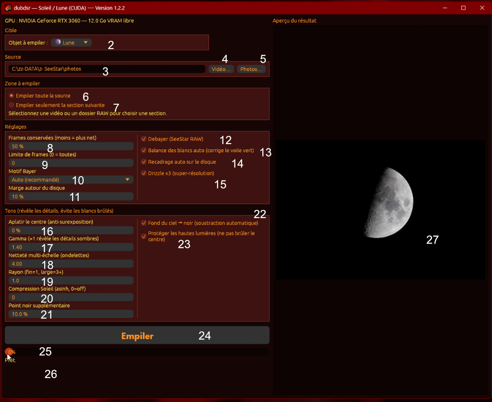

# dubdsr — Manuel de l'utilisateur

Version 1.2.2

dubdsr empile une vidéo RAW SeeStar ou une série de photos RAW d’appareil photo, Soleil ou Lune, sur une carte NVIDIA. Le résultat est un TIFF 16 bits.

Sous Windows, lancez `dubdsr.exe`. Sous Ubuntu, lancez `./dubdsr`. Le pilote NVIDIA déjà installé suffit. La fenêtre s’ouvre même si la carte n’est pas détectée ; l’empilement, lui, a besoin de la carte.

Deux profils sont gardés à part : **Soleil** et **Lune**. Chacun mémorise son chemin et tous ses réglages. Changer d’objet recharge l’autre profil. Tout est enregistré au fur et à mesure :

- Windows : `%APPDATA%\dubdsr\settings.json`
- Ubuntu : `$XDG_CONFIG_HOME/dubdsr/settings.json`, ou `~/.config/dubdsr/settings.json`

Les valeurs de la capture ci-dessous sont celles d’un profil Lune déjà modifié. Les valeurs de première utilisation sont rappelées dans chaque contrôle, et regroupées à la fin.

`Ctrl+L` fait défiler la langue : français, anglais, espagnol, allemand. Les libellés changent, les numéros de ce manuel restent ceux de l’écran français.

## La fenêtre

Les numéros sur la capture sont ceux des contrôles ci-dessous. Les titres de groupe (Cible, Source, Zone à empiler, Réglages, Tons) ne sont pas numérotés. Dans **Réglages** et dans **Tons**, les numéros descendent d’abord la colonne de gauche, puis la colonne de droite.

Dans le programme, le bouton **?** à droite du titre **Aperçu du résultat** ouvre une fenêtre avec cette capture et les mêmes textes. Le survol d’un contrôle affiche son texte sans ouvrir la fenêtre. La langue de l’aide suit `Ctrl+L`.

| N° | Contrôle sur la capture |
| --- | --- |
| 1 | Ligne GPU |
| 2 | Objet à empiler |
| 3 | Champ du chemin |
| 4 | Vidéo… |
| 5 | Photos… |
| 6 | Empiler toute la source |
| 7 | Empiler seulement la section suivante |
| 8 | Frames conservées |
| 9 | Limite de frames |
| 10 | Motif Bayer |
| 11 | Marge autour du disque |
| 12 | Debayer (SeeStar RAW) |
| 13 | Balance des blancs auto |
| 14 | Recadrage auto sur le disque |
| 15 | Drizzle x3 |
| 16 | Aplatir le centre |
| 17 | Gamma |
| 18 | Netteté multi-échelle |
| 19 | Rayon |
| 20 | Compression Soleil |
| 21 | Point noir supplémentaire |
| 22 | Fond du ciel → noir |
| 23 | Protéger les hautes lumières |
| 24 | Empiler |
| 25 | Barre de progression |
| 26 | Ligne d’état |
| 27 | Aperçu du résultat |

Le curseur de section, le temps et les fenêtres d’avertissement n’apparaissent pas sur cette capture. Ils sont numérotés à la suite, de 28 à 32.

Pour un champ numérique : cliquez la valeur, tapez le nombre, puis Entrée. Vous pouvez aussi faire glisser horizontalement. Le profil en cours est enregistré dès que la valeur change.

## 1. GPU

La ligne sous la barre de titre nomme la carte NVIDIA et indique sa mémoire en Go, par exemple `NVIDIA GeForce RTX 3060 — 12.0 Go VRAM libre`.

Rien à cliquer. Si le pilote manque, le texte devient `CUDA indisponible` et la fenêtre 30 s’ouvre. Le programme reste ouvert, mais **Empiler** échouera tant que la carte n’est pas détectée. Une vidéo trop longue, ou une série trop large pour la mémoire, s’arrête aussi avec un message explicite.

## 2. Objet à empiler

Liste **Soleil** ou **Lune**, dans le cadre **Cible**.

Cliquez le champ, puis choisissez l’objet. Le profil quitté garde son chemin et ses réglages. Le profil choisi revient avec son dernier chemin et ses propres valeurs. À la première utilisation, les deux profils partagent les mêmes réglages, sauf la balance des blancs (13) et l’aplatissement du centre (16).

## 3. Champ du chemin

Le champ **Source** montre le fichier AVI ou le dossier de photos qui sera empilé.

Collez ou tapez un chemin, puis cliquez ailleurs : dubdsr ouvre la source et met l’aperçu à jour. Le dossier du chemin devient le point de départ des boutons 4 et 5 pour ce profil. Un chemin vide, ou un dossier sans photo reconnue, laisse la source absente.

## 4. Vidéo…

Ouvre une vidéo AVI. La boîte de dialogue ne propose que les fichiers AVI et s’ouvre dans le dernier dossier de ce profil.

Choisissez la vidéo RAW du SeeStar, y compris un AVI de plus de 1 Go. Le TIFF sera écrit à côté d’elle : `nom_stacked.tiff`. Dès l’ouverture, l’aperçu (27) affiche l’image du milieu, en gris.

## 5. Photos…

Ouvre un dossier de photos RAW. Vous pouvez aussi coller son chemin dans le champ 3.

dubdsr lit les fichiers directement dans ce dossier, sans entrer dans les sous-dossiers, et les trie par nom. Extensions reconnues : `CR2`, `CR3`, `NEF`, `NRW`, `ORF`, `PEF`, `ARW`, `DNG`, `RAF`, `RW2`. Les JPEG et les XMP sont ignorés. Toute la série doit avoir la même taille et le même motif ; un fichier différent arrête l’empilement en le nommant. Le TIFF est écrit dans le dossier : `dossier_stacked.tiff`. L’aperçu montre la miniature embarquée du fichier du milieu, ou la mosaïque en gris si le fichier n’a pas de miniature.

## 6. Empiler toute la source

Premier choix du cadre **Zone à empiler**. C’est le choix actif au lancement d’une source.

Toute la vidéo, ou toutes les photos reconnues du dossier, est proposée à l’empilement. La limite de frames (9) peut encore en couper le début. La phrase sous les deux choix reste affichée : elle disparaît seulement quand le choix 7 est actif. Les deux choix sont inactifs tant qu’aucune source n’est ouverte.

## 7. Empiler seulement la section suivante

Deuxième choix du même cadre. Il limite l’empilement à un intervalle, bornes comprises.

Cliquez-le pour faire apparaître le curseur 28 à la place de la phrase d’aide. L’intervalle part de la première à la dernière image de la source. Revenir au choix 6 empile de nouveau toute la source, sans effacer l’intervalle mémorisé pour cette session.

## 8. Frames conservées (moins = plus net)

Part des images les plus nettes qui entrent vraiment dans la pile. Le pourcentage s’applique après la zone (6 ou 7) et après la limite (9).

Cliquez ou glissez. Le pas est de 5, de 10 % à 100 %. Une valeur tapée est ramenée au multiple de 5 le plus proche. Première utilisation : 10 %. Une valeur basse ne garde que les images les plus fines. 100 % garde tout ce qui a été lu. S’il y a assez d’images, au moins 3 sont conservées. Le décompte final s’affiche sur la ligne 26 : `gardées/lues`.

## 9. Limite de frames (0 = toutes)

Nombre maximum d’images lues dans la zone, en partant du début. 0 veut dire « pas de plafond ».

Cliquez ou glissez, de 0 à 100 000. Première utilisation : 0. Pour une vidéo, l’ordre est celui des images. Pour un dossier, l’ordre est celui des noms. Utile pour un essai court : une limite de 30 ne lit que les 30 premières images de la zone, puis le pourcentage (8) choisit les plus nettes parmi ces 30.

## 10. Motif Bayer

Liste du motif de la mosaïque couleur. **Auto (recommandé)** est le choix de première utilisation. Les autres choix sont `GRBG`, `GBRG`, `BGGR` et `RGGB`.

Cliquez le champ et choisissez une ligne. **Auto** sur une vidéo compare les quatre motifs et garde le plus propre. **Auto** sur un dossier RAW reprend le motif lu dans les fichiers. Un motif fixé force ce damier : un mauvais choix laisse une grille verte ou magenta. Le motif retenu est écrit à la fin sur la ligne 26 (`Bayer GRBG`, etc.). Cette liste n’a pas d’effet si le debayer (12) est décoché : la pile reste en gris. Une série déjà monochrome reste en gris même avec le debayer coché.

## 11. Marge autour du disque

Élargit le carré coupé autour du disque, en pourcentage. Elle n’agit que si le recadrage auto (14) est coché.

Cliquez ou glissez, de 1 % à 30 %. Première utilisation : 5 %. Une marge plus grande garde davantage de ciel autour du disque. Le carré suit l’étendue du disque : un croissant n’est pas recentré sur son bord brillant.

## 12. Debayer (SeeStar RAW)

Case à cocher. Cochée, dubdsr reconstruit la couleur à partir de la mosaïque Bayer. Décochée, l’empilement et le TIFF restent en niveaux de gris, sur un seul canal.

Cliquez la case ou son libellé. Première utilisation : cochée. Laissez-la cochée pour un RAW SeeStar couleur ou pour des photos couleur. Décochez-la pour une source déjà en gris, ou si vous voulez une pile monochrome.

## 13. Balance des blancs auto (corrige le voile vert)

Case à cocher. Après l’empilement couleur, les trois canaux du disque sont ramenés vers un gris neutre. Cela enlève le voile vert fréquent sur la Lune.

Cliquez la case. Première utilisation : cochée pour la Lune, décochée pour le Soleil. Le Soleil n’est pas un objet gris ; laissez la case décochée pour lui, sauf si un voile coloré domine. La case n’agit pas sur une pile en gris.

## 14. Recadrage auto sur le disque

Case à cocher. Cochée, dubdsr cherche le disque brillant et coupe un carré autour de lui. Décochée, l’image entière est empilée.

Cliquez la case. Première utilisation : cochée. Laissez-la cochée pour un Soleil ou une Lune isolés dans le champ. Décochez-la si le disque est mal détecté, ou si vous voulez garder tout le champ. La marge (11) n’est lue que lorsque cette case est cochée.

## 15. Drizzle x3 (super-résolution)

Case à cocher. Cochée, l’image de sortie est trois fois plus large et trois fois plus haute que le recadrage. Les petits décalages entre les images servent à remplir cette grille plus fine. Décochée, la sortie a la taille du recadrage.

Cliquez la case. Première utilisation : cochée. Le TIFF est alors beaucoup plus lourd. Gardez la case cochée quand plusieurs images nettes sont disponibles. Décochez-la pour un essai rapide ou si une seule image est conservée.

## 16. Aplatir le centre (anti-surexposition)

Réduit la bosse de lumière au centre du disque, pour montrer le détail sans brûler le milieu. 0 % laisse ce traitement éteint.

Cliquez ou glissez, de 0 % à 100 %. Première utilisation : 70 % pour le Soleil, 0 % pour la Lune. Montez la valeur si le centre du Soleil est blanc et que la granulation disparaît. Laissez 0 % sur la Lune, sauf si un bord est beaucoup plus sombre que le centre. Au-dessus de 0 %, la compression Soleil (20) et la protection des hautes lumières (23) ne sont plus appliquées : l’image est déjà remise à l’échelle par cet aplatissement.

## 17. Gamma (>1 révèle les détails sombres)

Courbe appliquée après l’étirement des tons. Au-dessus de 1, les zones sombres s’éclaircissent. En dessous de 1, elles s’assombrissent. 1 laisse la courbe droite.

Cliquez ou glissez, de 0,50 à 3,00, par pas de 0,05. Première utilisation : 1,20. Montez un peu, vers 1,40, pour sortir les mers de la Lune ou les zones peu lumineuses du Soleil. Une valeur trop haute éclaircit aussi le fond et le bruit.

## 18. Netteté multi-échelle (ondelettes)

Renforce le détail à quatre tailles, de la plus fine à la plus large. 0 éteint la netteté.

Cliquez ou glissez, de 0 à 6, par pas de 0,25. Première utilisation : 2,00. Montez si le disque reste mou après l’empilement. Une valeur haute accentue aussi le bruit et les bords. Le rayon (19) choisit la taille du détail le plus fin.

## 19. Rayon (fin=1, large=3+)

Taille du détail le plus fin renforcé par la netteté (18). Les trois passes suivantes doublent ce rayon à chaque fois.

Cliquez ou glissez, de 0,5 à 8, par pas de 0,5. Première utilisation : 1,0. Laissez 1 pour les cratères fins ou la granulation. Passez à 3 ou plus pour renforcer des structures plus larges. Ce champ n’a pas d’effet si la netteté est à 0.

## 20. Compression Soleil (asinh, 0=off)

Comprime les hautes lumières pour garder du détail dans le centre brillant. 0 éteint la compression.

Cliquez ou glissez, de 0 à 50. Première utilisation : 0. Montez par petites valeurs sur le Soleil si le centre claque alors que le limbe est bien exposé. Ce champ n’agit que lorsque l’aplatissement du centre (16) est à 0 %. Avec un aplatissement déjà réglé, laissez 0.

## 21. Point noir supplémentaire

Abaisse le plancher de l’image, en plus du fond du ciel (22), pour noircir le fond. La valeur est un percentile : plus elle est haute, plus les tons sombres sont coupés.

Cliquez ou glissez, de 0,0 % à 20,0 %, par pas de 0,1. Première utilisation : 0,1 %. Laissez une valeur basse. Une valeur haute mange le limbe et les protubérances. Si la case 22 est décochée, ce champ est la seule soustraction du fond.

## 22. Fond du ciel → noir (soustraction automatique)

Case à cocher. Cochée, dubdsr estime le niveau du ciel dans les coins et le soustrait, puis ramène vers le noir ce qui est en dehors du disque. Décochée, seule la soustraction du point noir (21) a lieu.

Cliquez la case. Première utilisation : cochée. Laissez-la cochée pour un fond de ciel uniforme. Décochez-la si un dégradé, un nuage ou un bord de champ très lumineux assombrit trop le disque.

## 23. Protéger les hautes lumières (ne pas brûler le centre)

Case à cocher. Cochée, le point blanc est le pixel le plus clair : le centre n’est pas écrêté. Décochée, le point blanc est à 99,7 % : le centre le plus brillant est un peu coupé, ce qui peut faire ressortir le reste du disque.

Cliquez la case. Première utilisation : cochée. Cette case n’agit que lorsque l’aplatissement du centre (16) est à 0 %. Avec un aplatissement déjà au-dessus de 0 %, le centre est géré par le réglage 16.

## 24. Empiler

Lance le travail avec la source, la zone et les réglages affichés. Le bouton occupe la largeur de la colonne de gauche.

Cliquez **Empiler**. Pendant le travail il est inactif : attendez la fin avant de relancer. Laissez la fenêtre ouverte. Si le chemin n’est ni un fichier ni un dossier, rien ne démarre et la fenêtre 31 s’ouvre.

Le TIFF 16 bits n’est écrit qu’à la réussite complète. Un nouvel empilement de la même source remplace le TIFF précédent.

- Vidéo `C:\...\soleil.avi` → `C:\...\soleil_stacked.tiff`
- Dossier `C:\...\photos` → `C:\...\photos\photos_stacked.tiff`

Couleur si un motif Bayer a été appliqué, gris sinon.

## 25. Barre de progression

Barre sous le bouton, avec le pourcentage. Elle part de 0 % au clic et atteint 100 % quand le TIFF est écrit.

Rien à cliquer. Elle avance pendant la lecture, le choix des images, l’alignement, le recadrage et l’empilement. Les tons et l’écriture du fichier se font à la fin de l’empilement : la barre peut rester un moment sur la même étape, puis passer à 100 %. Le libellé de l’étape est la ligne 26.

## 26. Ligne d’état

Texte sous la barre. Au repos : `Prêt.`

Pendant le travail, elle nomme l’étape. Sur une vidéo : lecture AVI, lecture des frames, transfert GPU, analyse de netteté, sélection des frames, alignement, recadrage, détection du motif Bayer, empilement super-résolu. Sur un dossier : lecture des RAW (fichier en cours et total), sélection, recadrage, puis passe en cours. À la réussite : `Terminé — gardées/lues frames`, le motif Bayer s’il y en a un, et le chemin du TIFF. En cas d’échec : `Erreur`, et la fenêtre 32 donne la raison.

## 27. Aperçu du résultat

Colonne de droite. Le titre reste `Aperçu du résultat`. L’image change selon le moment.

Avant **Empiler**, c’est la source. Une vidéo s’affiche en gris, éclaircie selon son pixel le plus clair. Un dossier RAW montre la miniature embarquée quand le fichier en contient une, donc souvent déjà en couleur ; sinon la mosaïque en gris. L’image affichée est celle du milieu de la source, puis celle sous la poignée du curseur 28 pendant un glisser. Cet aperçu est une vue écran : ce n’est pas encore le TIFF.

Après une réussite, l’aperçu est remplacé par l’image empilée, ramenée de 16 bits à 8 bits pour l’écran. Le fichier sur le disque reste en 16 bits.

## 28. Curseur de section

Absent de la capture : il remplace la phrase sous les choix 6 et 7 dès que **Empiler seulement la section suivante** est sélectionné.

Deux poignées orange marquent le début et la fin, bornes comprises. Faites glisser la poignée la plus proche du pointeur. Le début ne peut pas dépasser la fin. Sous le curseur, la ligne indique les numéros d’image. Pour une vidéo, la parenthèse est le temps (`minutes:secondes`). Pour un dossier, c’est le nom du fichier. L’aperçu suit la poignée en cours de glisser. La limite (9) s’applique ensuite à l’intérieur de cet intervalle, depuis son début.

## 29. Temps

Ligne qui apparaît sous la ligne d’état (26) pendant et après un empilement.

Pendant le travail : `Temps écoulé`. Après une réussite : `Temps total`. Après un échec : `Arrêté après`, avec la durée déjà écoulée. Rien à cliquer.

## 30. Avertissement au démarrage

Fenêtre centrée, titre `dubdsr — avertissements au démarrage`. Elle s’ouvre si la carte NVIDIA n’est pas utilisable, et reste là tant que vous ne la fermez pas.

Lisez le détail, puis cliquez **OK** ou la croix. La fenêtre principale reste ouverte. L’empilement échouera avec le même genre de message tant que le pilote n’est pas disponible.

## 31. Fichier manquant

Fenêtre centrée qui s’ouvre si **Empiler** est cliqué alors que le chemin n’est ni un fichier ni un dossier.

Le texte demande de sélectionner un fichier AVI ou un dossier RAW. Cliquez **OK**. Choisissez ensuite une source avec 4, 5 ou le champ 3.

## 32. Échec de l'empilement

Fenêtre centrée qui s’ouvre si le travail s’arrête. Le TIFF n’a pas été écrit.

Le texte donne la raison : vidéo illisible, dossier RAW vide, fichier qui ne va pas avec la série, format non pris en charge, mémoire de la carte insuffisante, ou écriture impossible. Cliquez **OK**. La ligne 26 reste sur `Erreur`, et la ligne 29 indique depuis combien de temps le travail était lancé. Corrigez la source ou un réglage, puis relancez avec 24.

## Valeurs à la première utilisation

| Contrôle | Soleil | Lune |
| --- | --- | --- |
| 8 Frames conservées | 10 % | 10 % |
| 9 Limite de frames | 0 | 0 |
| 10 Motif Bayer | Auto | Auto |
| 11 Marge | 5 % | 5 % |
| 12 Debayer | coché | coché |
| 13 Balance des blancs | décoché | coché |
| 14 Recadrage auto | coché | coché |
| 15 Drizzle x3 | coché | coché |
| 16 Aplatir le centre | 70 % | 0 % |
| 17 Gamma | 1,20 | 1,20 |
| 18 Netteté | 2,00 | 2,00 |
| 19 Rayon | 1,0 | 1,0 |
| 20 Compression Soleil | 0 | 0 |
| 21 Point noir | 0,1 % | 0,1 % |
| 22 Fond du ciel | coché | coché |
| 23 Protéger les hautes lumières | coché | coché |

Ces valeurs reviennent seulement si le fichier de réglages est absent. Un profil déjà utilisé rouvre ses dernières valeurs, comme sur la capture.
